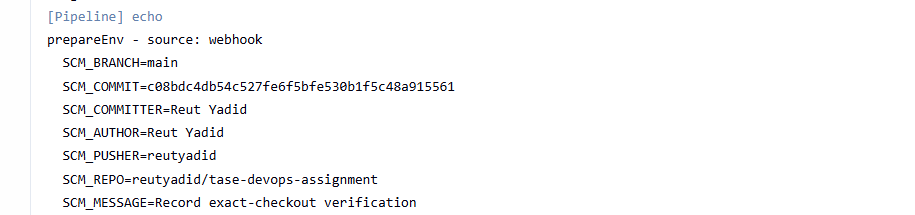

# Task 1 — Jenkins pipeline with a Groovy shared library

A push to `main` on GitHub starts a Jenkins pipeline that **builds** a small Java app,
**packs** it into a jar and **uploads** it to a Nexus Maven repository. The first stage calls
`prepareEnv()` from a Groovy shared library: it reads the SCM trigger parameters from the
webhook (committer, author, pusher, commit, branch, repo, message), makes them available to the
pipeline as `SCM_*` environment variables, shows `<sha> by <committer>` in the build history and
writes them into the jar's `MANIFEST.MF`.

Everything runs locally with Docker Compose and is configured as code: no clicks in the UI.



## Architecture

```
GitHub push ──> smee.io ──> smee client ──> Jenkins controller ──SSH──> agent ──mvn deploy──> Nexus
   (webhook)    (public relay)  (container)   Generic Webhook Trigger    (runs the build)   maven-releases
```

| Service   | Image                                    | Role                                            | Port (host)        |
|-----------|------------------------------------------|-------------------------------------------------|--------------------|
| `jenkins` | `jenkins/jenkins:2.580.2-lts-jdk21` + plugins + JCasC | UI, job, trigger; 0 executors          | `127.0.0.1:8080`   |
| `agent`   | `jenkins/ssh-agent:9.3.2-jdk21`          | Runs every build (Java 21, Maven via `mvnw`)    | none               |
| `nexus`   | `sonatype/nexus3:3.98.1`                 | Maven repository `maven-releases`               | `127.0.0.1:8081`   |
| `smee`    | `node:24.22-alpine3.24` + `smee-client@5.0.0` | Forwards GitHub webhooks to Jenkins        | none               |

Pipeline stages (`Jenkinsfile`):

| Stage   | What it does                                                                 | Requirement |
|---------|------------------------------------------------------------------------------|-------------|
| Prepare | Checks out the pushed commit, calls `prepareEnv(gitVars)`                    | R-6, R-7, R-8 |
| Build   | `./mvnw clean test` — compile and unit tests                                 | R-3         |
| Package | `./mvnw package` — `hello-app-1.0.<build>.jar` with `SCM-*` manifest entries | R-4, R-8    |
| Upload  | `./mvnw -s settings.xml deploy` inside `withCredentials` → Nexus              | R-5         |

## Prerequisites

- Docker Engine / Docker Desktop with Docker Compose v2 (tested: Docker 29.9.3, Compose v5.7.0
  on Windows 11 + WSL2 Ubuntu 24.04)
- About 4.5 GB of free memory for the containers (Nexus 2 GB, Jenkins 1 GB, agent 1 GB, smee 128 MB)
- `bash`, `git`, `curl`, `openssl`, `ssh-keygen`, `unzip` (only for the manifest check)
- A GitHub account and a **public** fork of this repository (Jenkins reads the Jenkinsfile and the
  shared library from it, and GitHub sends the webhook from it)

## Quick start

All commands run from `1-jenkins-pipeline/` in your clone of your fork. Replace `YOUR-USER`
with your GitHub user name.

**1. Create `.env` with random passwords**

```bash
cp .env.example .env
for v in NEXUS_ADMIN_PASSWORD NEXUS_DEPLOY_PASSWORD JENKINS_ADMIN_PASSWORD GWT_TOKEN; do
  sed -i "s|^$v=.*|$v=$(openssl rand -hex 16)|" .env
done
sed -i "s|^GIT_REPO_URL=.*|GIT_REPO_URL=https://github.com/YOUR-USER/tase-devops-assignment.git|" .env
```

Nexus Community Edition needs its EULA accepted before it accepts uploads. Read
<https://links.sonatype.com/products/nxrm/ce-eula>; only if you agree:

```bash
sed -i 's|^NEXUS_ACCEPT_EULA=.*|NEXUS_ACCEPT_EULA=true|' .env
```

**2. Create the agent SSH key**

```bash
mkdir -p secrets && ssh-keygen -t ed25519 -N "" -C jenkins-agent -f secrets/agent_key
chmod 644 secrets/agent_key
sed -i "s|^JENKINS_AGENT_SSH_PUBKEY=.*|JENKINS_AGENT_SSH_PUBKEY=\"$(cat secrets/agent_key.pub)\"|" .env
```

**3. Create the webhook relay**

1. Open <https://smee.io>, click **Start a new channel**, copy the channel URL.
2. Put it in `.env`: `sed -i "s|^SMEE_URL=.*|SMEE_URL=https://smee.io/<channel>|" .env`
3. In your fork on GitHub: **Settings → Webhooks → Add webhook**. Payload URL = the channel URL,
   Content type = `application/json`, **Just the push event**.

The channel URL works like a password: do not share it.

**4. Start everything and configure Nexus**

```bash
docker compose up -d --build
./nexus/setup.sh
```

`setup.sh` first checks every value in `.env` and stops with a clear message if one is missing or
still a placeholder. It does not continue unless `NEXUS_ACCEPT_EULA=true`. Then it waits for Nexus
(the first start takes 2-4 minutes), replaces the random admin password, accepts the EULA and
creates the least-privilege deploy user. It is safe to run again.

**5. Trigger the pipeline**

Push any commit to `main` of your fork, for example:

```bash
git commit --allow-empty -m "Trigger the pipeline" && git push
```

## How to verify

Jenkins: <http://localhost:8080>, user `admin`, password = `JENKINS_ADMIN_PASSWORD` in `.env`.

| Check | Where | Expected |
|-------|-------|----------|
| Trigger from SCM (R-2) | Job `hello-app` → newest build | Cause `Push to main by <your GitHub user>`, started a few seconds after the push |
| Shared library (R-6) | Build → Console Output, top | `Loading library tase-shared-lib@main` |
| `prepareEnv` (R-7, R-8) | Console Output, Prepare stage | `prepareEnv - source: webhook` and 7 `SCM_*` values, e.g. `SCM_PUSHER=<your GitHub user>` |
| Build description (R-8) | Job page, build history | `<short sha> by <committer>` |
| Build + tests (R-3) | Console Output, Build stage | `Tests run: 1, Failures: 0` |
| Upload (R-5) | Console Output, Upload stage | `Uploaded to nexus-releases: ... hello-app-1.0.<build>.jar`; `Finished: SUCCESS`. The next line, `Skipping already-deployed ...`, is only information: the deploy plugin (3.2.0) notes that this project was already uploaded in this run; nothing is skipped |
| Artifact in Nexus (R-5) | <http://localhost:8081> → Browse → `maven-releases` → `com/example/hello-app` (log in as `admin`, password `NEXUS_ADMIN_PASSWORD`) | Version `1.0.<build>`, uploader `jenkins-deploy` |

SCM values inside the uploaded jar (replace `<build>`):

```bash
B=2   # the build number to check
( set -a; source .env; set +a      # in a subshell: the secrets do not stay in your shell
  curl -fsS -u "$NEXUS_DEPLOY_USER:$NEXUS_DEPLOY_PASSWORD" -o /tmp/hello-app.jar \
    "http://localhost:8081/repository/maven-releases/com/example/hello-app/1.0.$B/hello-app-1.0.$B.jar" ) \
  && unzip -p /tmp/hello-app.jar META-INF/MANIFEST.MF
# expected: SCM-Branch: main, SCM-Commit: <sha>, SCM-Committer: <name>, SCM-Pusher: <user>, ...
```

A manual **Build Now** also works: `prepareEnv` then reads the values from git and sets
`SCM_PUSHER=manual`.

Screenshots of the clean run (webhook build #2): [build history](docs/screenshots/01-build-history.png),
[build cause](docs/screenshots/02-build-cause.png),
[prepareEnv log](docs/screenshots/03-prepareenv-log.png),
[upload log](docs/screenshots/04-upload-log.png),
[Nexus versions](docs/screenshots/05-nexus-versions.png),
[Nexus jar details](docs/screenshots/06-nexus-jar-details.png),
[GitHub webhook deliveries](docs/screenshots/07-github-webhook.png).

Stop: `docker compose down`. Remove all data too: `docker compose down -v`.

## Project structure

```
1-jenkins-pipeline/
├── Jenkinsfile                      # pipeline: Prepare → Build → Package → Upload
├── shared-library/vars/
│   └── prepareEnv.groovy            # the shared library function (SCM trigger parameters)
├── app/                             # Java 21 app built by the pipeline
│   ├── pom.xml                      # ${revision} version, SCM-* manifest entries, Nexus target
│   ├── settings.xml                 # Nexus credentials from env vars (no secrets)
│   ├── mvnw, .mvn/wrapper/          # Maven Wrapper (Maven 3.10.0, checksum-verified)
│   └── src/
├── jenkins/
│   ├── Dockerfile                   # LTS image + pinned plugins + JCasC
│   ├── plugins.txt                  # every plugin version pinned
│   ├── casc.yaml                    # security, agent, credentials, shared library, job
│   └── jobs/hello_app.groovy        # Job DSL: pipeline job + Generic Webhook Trigger
├── nexus/setup.sh                   # one-time Nexus setup (admin password, EULA, deploy user)
├── smee/Dockerfile                  # webhook relay client
├── docker-compose.yml               # jenkins, agent, nexus, smee; memory limits; secrets
├── .env.example                     # all settings; copy to .env (git-ignored)
├── docs/screenshots/
├── REQUIREMENTS.md                  # task text + requirements matrix
├── DECISIONS.md                     # design decisions (D-001 … D-012)
└── TROUBLESHOOTING.md               # real problems and fixes
```

## Requirements coverage

See [REQUIREMENTS.md](REQUIREMENTS.md): every requirement of the task, where it is implemented,
how it was verified, and its status.

## Design decisions

See [DECISIONS.md](DECISIONS.md). Key points:

- **Shared library** in the same repo, loaded with `@Library` + `libraryPath` (D-001).
- **Trigger:** GitHub webhook → smee.io → Generic Webhook Trigger, so the push payload itself
  reaches the pipeline; filtered to pushes to `main` (D-002).
- **`prepareEnv`:** 7 `SCM_*` values from the payload, git fallback on manual runs; every build
  checks out exactly the pushed commit, so the manifest always names what was built (D-004).
- **Builds only on a dedicated SSH agent**; the controller has 0 executors (D-005, D-006).
- **Configured as code:** pinned `plugins.txt`, JCasC, Job DSL (D-007).
- **Unique version per build** `1.0.<build number>` with Maven CI-friendly `${revision}` (D-009);
  upload with `mvn deploy` (D-010).

## Security notes

- **No secrets in git.** All passwords, the webhook token and the smee URL are in `.env`
  (git-ignored); the SSH key is in `secrets/` (git-ignored).
- **Secrets as files.** Jenkins and smee get them as Docker secrets in `/run/secrets/`; JCasC reads
  them with `${readFile:...}`. They are not visible in `docker inspect`. Exception: the smee client
  receives the channel URL and the webhook token as arguments and prints both in its log
  (`docker compose logs smee`), so anyone with Docker access on this machine can read them (D-002).
- **Least privilege.** Nexus deploy user can only read and upload to `maven-releases` (D-011).
  Jenkins and Nexus require a login (no anonymous access). Builds run on the agent, not on the
  controller. Jenkins, Nexus and smee run as non-root users; in the agent container only
  `sshd` runs as root, and the builds run as the `jenkins` user.
- **Untrusted SCM data.** Webhook values are only stored in env vars; shell steps use single
  quotes, so no value is pasted into a command (D-001).
- **Credentials in the build** exist only inside `withCredentials` and are masked in the log.
- **Ports** are bound to `127.0.0.1` only; the agent and smee publish none.
- **Pinned versions:** images, plugins, Maven, Maven Wrapper (with checksums), Maven plugins.

## Known limitations / what I'd add in production

- **Host provisioning with Terraform + Ansible.** Here Jenkins runs on a laptop with
  `docker compose up`. On a real server: Terraform creates the host, Ansible installs Docker,
  copies the Compose files and manages secrets (e.g. Ansible Vault). Jenkins itself is still
  configured by JCasC + Job DSL (see D-007). Ansible was left out of this task on purpose: it
  would only wrap `docker compose up` and add a prerequisite for the reviewer.
- **Internal proxy for downloads.** Here `mvnw` downloads Maven and dependencies directly from
  Maven Central (checksum-verified, see D-008). In production: route them through an internal
  proxy repository (e.g. Nexus, `MVNW_REPOURL` + a `settings.xml` mirror).
- **Build metadata.** Here `prepareEnv` fails the build if the commit or committer is missing, and
  local builds (outside Jenkins) leave `${env.SCM_*}` as text in the manifest. In production:
  enforce all fields in the build (Maven Enforcer) and publish signed build provenance (SLSA).
- **Nexus Community Edition limits.** CE requires mandatory telemetry; since 3.98, if reporting
  fails for 30 days, Nexus becomes read-only. CE also has usage limits. For production: Nexus Pro
  (or another licensed repository), sized per Sonatype's memory guidance, with backups.
- **Nexus URL per environment.** Here `http://nexus:8081` is written in `app/pom.xml` and
  `app/settings.xml` (one environment, two lines next to each other). In production the URL
  comes from the CI configuration per environment, and Nexus is served over HTTPS.
- **Builds on every push to `main`.** The trigger filters by branch, not by folder, so a push
  that changes only another task in this repository also starts a build (D-002). In production:
  one repository per application, or a path filter on the changed files.
- **Webhook endpoint.** smee.io is a development relay. In production: an inbound HTTPS endpoint
  for Jenkins and HMAC verification of GitHub's `X-Hub-Signature-256` (D-002).
- **Agent host keys and secrets.** Here the agent's SSH host key is not verified and the private
  key file is mode 644 (D-006). In production: fixed host keys with verification, and secrets
  from a secrets manager.
